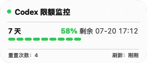

# CodexQuotaBar

[](https://github.com/Shadowyuan616/CodexQuotaBar/actions/workflows/ci.yml)
[](https://www.apple.com/macos/)
[](#requirements)
[](LICENSE)

**English** | [简体中文](docs/README.zh-CN.md)

CodexQuotaBar is a lightweight macOS menu bar utility that displays your Codex
quota, reset time, and refresh health through the official local ChatGPT/Codex
app-server.

> This is an independent community project. It is not affiliated with or
> endorsed by OpenAI. Codex, ChatGPT, and related names are trademarks of their
> respective owners.



## Features

- Compact menu bar status with remaining quota, reset time, and an API health indicator.
- Supports both 5-hour plus weekly limits and accounts with a weekly limit only.
- Automatically switches the menu bar value and reset label when no 5-hour limit is returned.
- Fixed auto-refresh choices: 10 seconds, 30 seconds, 1 minute, 5 minutes, and 15 minutes.
- Keeps the last quota value visible while refreshing; only the health indicator turns blue.
- Native Liquid Glass on macOS 26 and later.
- `NSVisualEffectView` compatibility fallback on macOS 14-25.
- Local cache for the latest successful quota response, with sanitized error states.
- Readable in both light and dark appearance.

## Requirements

### Running the app

| Requirement | Supported configuration |
| --- | --- |
| macOS | macOS 14.0 or later |
| Processor | Apple Silicon (`arm64`) |
| ChatGPT | `/Applications/ChatGPT.app`, signed in to a Codex-enabled account |
| Legacy fallback | `/Applications/Codex.app` is still recognized |

macOS 14-25 uses the compatibility visual effect. macOS 26 and later uses
native Liquid Glass. macOS 13 and earlier are not supported.

### Building from source

- Xcode 26 or later, or Command Line Tools containing the macOS 26+ SDK.
- Git.

The source needs a recent SDK to compile the Liquid Glass types. The generated
application still has a minimum runtime target of macOS 14.0.

## Installation

### Current option: build from source

This repository does not currently distribute an unsigned binary. This avoids
asking users to bypass Gatekeeper warnings.

```bash
git clone https://github.com/Shadowyuan616/CodexQuotaBar.git
cd CodexQuotaBar
bash scripts/test.sh
bash scripts/build.sh
open dist/CodexQuotaBar.app
```

The app is written to `dist/CodexQuotaBar.app`. To install the local build in
Applications:

```bash
ditto dist/CodexQuotaBar.app /Applications/CodexQuotaBar.app
open /Applications/CodexQuotaBar.app
```

Set `OUTPUT_DIR` to choose another build destination:

```bash
OUTPUT_DIR="$HOME/Desktop/CodexQuotaBar-build" bash scripts/build.sh
```

## Usage

1. Install and sign in to the official ChatGPT app for macOS.
2. Launch `CodexQuotaBar.app`.
3. Click the quota capsule in the menu bar to open the panel.
4. Use the refresh icon to query immediately, the gear icon to select an
   automatic refresh interval, and the close icon to quit.

The menu bar number displays the 5-hour remaining quota when that limit exists.
If the account has no 5-hour limit, it displays the weekly remaining quota.

The health indicator is green when online, blue while refreshing, red on an
error, and gray when unavailable. Quota colors are based on the amount
remaining: green for 20%-100%, yellow for 5%-20%, and red for 0%-5%.

## Privacy and security

CodexQuotaBar does not directly read `~/.codex/auth.json`, Keychain items,
browser cookies, access tokens, refresh tokens, or API keys. Authentication is
delegated to the official local `codex app-server` process.

The app requests only:

```text
account/rateLimits/read
```

It does not request `account/read` or `account/usage/read`. Local persistence is
limited to quota data, refresh timestamps, and daily quota percentages. Account
email, token usage, credentials, and raw service errors are not stored. See
[SECURITY.md](SECURITY.md) for the complete security boundary.

## Development

```bash
# Core and UI tests
bash scripts/test.sh

# Render a panel preview
bash scripts/render-preview.sh

# Build a local app bundle
bash scripts/build.sh
```

The project intentionally uses a small shell-based Swift/AppKit build rather
than requiring an Xcode project.

## Signed releases and one-command installation

The recommended distribution path is:

1. Sign the app with Developer ID and enable Hardened Runtime.
2. Submit it to Apple Notary Service and staple the notarization ticket.
3. Attach the signed, notarized ZIP or DMG to a GitHub Release.
4. Publish a Homebrew Cask through a personal tap:

   ```bash
   brew tap Shadowyuan616/tap
   brew install --cask codex-quota-bar
   ```

5. Add Sparkle later for in-app updates.

The repository already includes the signing and notarization script:

```bash
DEVELOPER_ID_APPLICATION="Developer ID Application: Your Name (TEAMID)" \
NOTARY_PROFILE="codex-quota-notary" \
bash scripts/release-build.sh
```

No binary asset is attached yet because the maintainer machine does not
currently have a Developer ID certificate. The Homebrew Cask will be enabled
after the first signed and notarized release.

## Known limitations

- The app relies on the local ChatGPT/Codex app-server protocol. Upstream
  protocol changes may require updates.
- Current builds target Apple Silicon only; Intel Macs are not supported.
- Launch at Login is not built in yet. Add the app manually in macOS Login Items
  if needed.

## Contributing

Issues and pull requests are welcome. Please include the macOS version, ChatGPT
app version, and a sanitized error summary when reporting a quota refresh issue.
Never attach credentials, tokens, `auth.json`, or raw private logs.

## License

[MIT](LICENSE)
