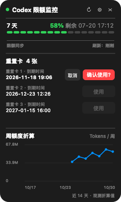

# CodexQuotaBar / Codex 限额栏

[English](../README.md) | **简体中文**

一款轻量的 macOS 菜单栏工具，通过本机 ChatGPT/Codex 应用内置的
`codex app-server` 显示 Codex 剩余限额、重置时间和刷新状态。

> 这是独立社区项目，与 OpenAI 没有隶属或官方合作关系。Codex、ChatGPT
> 及相关名称是其各自权利人的商标。


预览使用示例数据。

## 功能

- 在菜单栏紧凑显示当前剩余额度、重置时间和 API 状态灯。
- 同时兼容“5 小时 + 7 天”双限额以及仅有周限额的账户。
- 在没有 5 小时限额时，自动改为显示周剩余量和周重置日期/时间。
- 支持 10 秒、30 秒、1 分钟、5 分钟和 15 分钟自动刷新。
- 刷新时保留已有额度数字，仅将状态灯切换为蓝色。
- 按到期时间排列重置卡，提供行内确认和取消按钮，仅最早到期的卡片可使用。
- 按天展示周额度折算 Token 趋势，展开面板保持 250pt 宽。
- macOS 26 及以上使用原生 Liquid Glass。
- macOS 14-25 自动使用 `NSVisualEffectView` 兼容效果。
- 本地缓存最近一次成功数据；失败时继续展示缓存并显示脱敏状态。
- 浅色和深色模式均可读。

## 系统要求

### 运行 App

| 项目 | 要求 |
| --- | --- |
| 操作系统 | macOS 14.0 或更高版本 |
| 处理器 | Apple Silicon（当前构建为 `arm64`） |
| ChatGPT | `/Applications/ChatGPT.app`，且已登录 Codex 可用账户 |
| 兼容项 | 仍支持 `/Applications/Codex.app` 旧版应用路径 |

macOS 14-25 使用兼容毛玻璃；macOS 26 及以上显示原生 Liquid Glass。
macOS 13 及以下目前不受支持。

### 从源码构建

- Xcode 26 或更高版本，或者包含 macOS 26+ SDK 的 Command Line Tools。
- Git。

源码需要新 SDK 才能识别 Liquid Glass 类型，但生成的 App 最低运行版本仍是
macOS 14.0。

## 安装

### 当前方式：从源码构建

当前仓库暂不提供未经 Apple 签名、公证的二进制下载，避免要求用户绕过
Gatekeeper 安全提示。

```bash
git clone https://github.com/Shadowyuan616/CodexQuotaBar.git
cd CodexQuotaBar
bash scripts/test.sh
bash scripts/build.sh
open dist/CodexQuotaBar.app
```

构建脚本默认把 App 输出到 `dist/CodexQuotaBar.app`。如需安装到“应用程序”：

```bash
ditto dist/CodexQuotaBar.app /Applications/CodexQuotaBar.app
open /Applications/CodexQuotaBar.app
```

可以用 `OUTPUT_DIR` 修改输出位置：

```bash
OUTPUT_DIR="$HOME/Desktop/CodexQuotaBar-build" bash scripts/build.sh
```

## 使用方法

1. 安装并登录官方 ChatGPT Mac App。
2. 启动 `CodexQuotaBar.app`。
3. 点击菜单栏中的额度胶囊打开面板。
4. 点击刷新图标立即查询；点击齿轮选择自动刷新间隔；点击关闭图标退出。

存在 5 小时限额时，状态栏显示 5 小时剩余额度；不存在时显示周剩余额度。

状态灯为绿色表示正常、蓝色表示刷新中、红色表示异常、灰色表示未检测。
额度颜色按剩余量变化：20%-100% 为绿色，5%-20% 为黄色，0%-5% 为红色。

## 重置卡与 Token 趋势

展开面板保持 250pt 宽，新增重置卡和周额度折算曲线。重置卡按到期时间从近到远逐行显示，时间精确到分钟，
仅最早到期的可用卡所在行启用“使用”按钮。超过三行可在列表内滚动；详情不完整时暂不可使用。

1. 点击最早到期卡片所在行的“使用”，首次点击不兑换卡片。
2. 按钮变为红色“确认使用？”，8 秒内再次点击才触发兑换。
3. 点击左侧“取消”可恢复原状态；收起面板、刷新或超过 8 秒也会取消确认。



是否满足重置条件由服务端判断。结果不确定时重试同一请求编号，且绑定原账户，避免重复扣卡。

曲线展示近 14 天的观测值，公式为：`Token 增量 ÷（周额度已用百分点增量 / 100）`。
例如消耗 10 万 Tokens 使用了 2% 周额度，折算整周为 500 万 Tokens。
每天按增量合计计算，不平均各次比值。成功刷新后采样，间隔至少 5 分钟；仅合并同日、同一额度周期内的配对数据。
跨日、额度重置、账户或套餐变化、计数回退会重建基线。安装后需等待有效额度变化才会出现数据点，
不能从旧百分比记录反推 Token 历史。账户 Token 统计与限额计费可能口径不同，因此这是观测估算，非官方固定上限。
悬停曲线可查看每日明细。

Token 接口暂不可用时会保留已有趋势，限额刷新不受影响。接口说明见
[OpenAI 官方 App Server 文档](https://learn.chatgpt.com/docs/app-server)。

## 数据与隐私

CodexQuotaBar 不直接读取 `~/.codex/auth.json`、Keychain、浏览器 Cookie、访问令牌、
刷新令牌或 API Key。身份验证由官方本地 `codex app-server` 完成。

应用使用以下本地接口：

```text
account/rateLimits/read
account/usage/read
account/rateLimitResetCredit/consume  # 仅点击两次确认后调用
```

应用不请求 `account/read`。本地保存限额和卡片详情、刷新时间、一个累计 Token 采样基线、每日 Token/额度增量及账户/套餐的哈希。
待确认结果的兑换保存唯一请求编号、所选卡片 ID 和账户哈希。不会保存原始账户 ID、邮箱、凭据或原始服务端错误。完整说明见
[SECURITY.md](../SECURITY.md)。

## 开发与验证

```bash
# 核心与 UI 测试
bash scripts/test.sh

# 生成界面预览
bash scripts/render-preview.sh

# 构建本地调试 App
bash scripts/build.sh
```

## 已知限制

- 依赖 ChatGPT/Codex 本地 app-server 协议；上游协议变更可能需要同步适配。
- 当前产物仅为 Apple Silicon `arm64`，不支持 Intel Mac。
- 当前没有内置“登录时自动启动”，可在 macOS 登录项中手动添加。

## 参与贡献

欢迎提交 Issue 和 Pull Request。报告刷新问题时，请提供 macOS 版本、ChatGPT
App 版本和脱敏后的错误摘要。请勿上传凭据、Token、`auth.json` 或原始隐私日志。

## 许可证

[MIT](../LICENSE)
